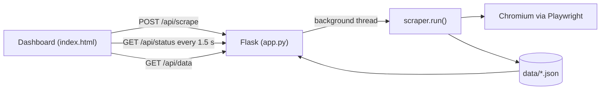

# Instagram Profile Analyzer

An academic project that reads a **public Instagram profile** with a real browser (Playwright) and turns it into something you can explore: profile counters, a long list of posts and, for the most recent ones, the full caption, the likes and the comments. Everything runs locally from a small web dashboard.

It exists to show, end to end, how a dynamic website is scraped without hiding the mechanics behind a scraping library: sessions, waits, infinite scroll, parsing, and a background job reported to a web UI.

| Level | What is collected | How many |
|---|---|---|
| Profile | Followers, following, post count, biography | 1 |
| Posts | URL, type (post or reel), image description | 50 by default |
| Detailed posts | Caption, likes, comment count, date, comments | The first 10 by default |

## Run it

Requires Python 3.9 or newer.

```bash
git clone https://github.com/jhon-avilat/instagram-profile-analyzer.git
cd instagram-profile-analyzer

python -m venv venv
# Windows (PowerShell): venv\Scripts\Activate.ps1
# macOS / Linux:        source venv/bin/activate

pip install -r requirements.txt
playwright install chromium

python app.py
```

Your browser opens at <http://127.0.0.1:5000>. Type a username, choose how many posts to collect and how many to read in detail, and press **Scrape profile**. Progress is shown live and the results replace the page content when the job ends. Data from the previous run is shown on startup.

The scraper also works without the dashboard and writes the same files:

```bash
python scraper.py usuer_random -n 80 -d 15 --headless
```

### Signing in

Instagram limits anonymous visitors, so a logged-in session is needed. Use a **secondary test account**.

- **Log in by hand (most reliable).** Leave `INSTAGRAM_SESSIONID` empty. On the first run Chromium opens on the login page; sign in there and the scraper continues on its own. The session is kept in `browser_profile/` and reused afterwards. Headless mode cannot ask you to log in, so do this once with the window visible.
- **Session cookie (optional).** Copy `.env.example` to `.env`, then paste the `sessionid` value found in DevTools (`F12` > Application > Cookies > `https://www.instagram.com`), with no quotes or spaces. It is injected before the first request. Instagram often rejects a cookie copied to another browser; when that happens the scraper falls back to the manual login. A stale cookie overrides a good saved session, so remove it from `.env` if you stop using it.

Both the `sessionid` and `browser_profile/` are equivalent to a password. They are git-ignored; keep them out of every commit.

## How it works



1. **Session.** A persistent browser profile keeps the login between runs. If a cookie is configured it is injected first; if Instagram still shows the login page, `wait_for_login()` waits while you sign in.
2. **Waiting.** `wait_for_selector()` polls the DOM until the header and a post link exist, instead of sleeping for a fixed time. Random pauses between actions keep the rhythm irregular.
3. **Profile.** Counters are read from the `og:description` meta tag (the text used for link previews) with regular expressions that accept English and Spanish. The biography is the header text that follows the "following" line.
4. **Infinite scroll.** The grid is scrolled by 90% of the window height at a time. Links are read after every scroll and de-duplicated by URL, because Instagram removes off-screen posts from the DOM. The loop ends at the target or after six scrolls without news.
5. **Post details.** The first N posts are opened one by one. Caption, likes and comment count come from that page's `og:description`; the counters are read only from the text before the first ` - `, so a caption cannot fake them. If the owner hides likes the value stays `null`. Comments are read from the page with a small DOM script, after clicking "load more" up to five times. Only top-level comments are collected, up to 20 per post.
6. **Privacy at the source.** Commenters never reach the disk with their real names: the profile owner becomes `owner`, everyone else becomes `user_1`, `user_2`, and so on, and `@mentions` in captions and comments become `@user`. The name-to-label mapping lives only in memory during the run, so it cannot be reversed afterwards.
7. **Persistence.** Results are written to `data/profile.json` and `data/posts.json`.
8. **Background job.** `POST /api/scrape` validates the input and starts the scraper in a thread. The page polls `GET /api/status`, which reports the stage (collecting posts, then reading details) and its progress. Only one job runs at a time.

## Design decisions

| Decision | Considered | Why this one |
|---|---|---|
| Playwright | Selenium; Requests + BeautifulSoup | Instagram is rendered by JavaScript, which Requests never runs. Selenium would also work; Playwright gives automatic waiting and a one-call persistent profile. |
| Persistent browser profile | Cookie only | A copied `sessionid` is tied to the browser that created it and is often rejected. A profile logged in by hand is the same browser the scraper uses. |
| Flask | Django; FastAPI; Streamlit | Four routes do not justify Django. FastAPI would be equally valid, but its async model brings nothing to a synchronous scraper. Streamlit would hide the HTTP layer. |
| Vanilla JavaScript | React | A single page with no build step. The UI only talks to the JSON API, so it can be replaced later without touching the backend. |
| JSON files | SQLite or PostgreSQL | One profile at a time, readable at a glance. A database makes sense once history across profiles is needed. |
| Detail for a few posts | Detail for every post | Each opened post is one more page load. A small number keeps the run short and the account out of trouble. |
| Polling | WebSockets | A status request every 1.5 seconds is enough for one local user and needs no extra dependency. |
| Anonymize while scraping | Anonymize later | What is never stored cannot leak. |

## Data

`data/profile.json`

```json
{
  "username": "elrubiusomg",
  "followers": "12.4K",
  "following": "310",
  "posts_count": "2,100",
  "biography": "Display name\nBio text",
  "scraped_at": "2026-10-19T14:30:00+00:00"
}
```

Profile counters stay as text exactly as Instagram shows them (`"12.4K"`), because a separator can mean thousands or decimals depending on the language. Per-post counters are integers.

`data/posts.json` holds one object per post. Detailed posts add the fields below; the rest only have `url`, `type` and `description`.

```json
{
  "url": "https://www.instagram.com/p/XXXXXXXXXXX/",
  "type": "post",
  "description": "Photo by ... May be an image of ...",
  "caption": "Text written by the author",
  "likes": 1234,
  "comments_count": 56,
  "posted_at": "2025-10-01T12:00:00.000Z",
  "comments": [
    {"author": "user_1", "text": "Great shot"},
    {"author": "owner", "text": "Thank you"}
  ]
}
```

The `description` is Instagram's automatic image alt text, not something the author wrote; the caption is.

## Project map

```
instagram-profile-analyzer/
├── app.py              Entry point: dashboard, JSON API, background job, statistics
├── scraper.py          Browser automation, parsing and persistence; also a CLI
├── templates/
│   └── index.html      Dashboard (HTML, CSS and vanilla JS in one file)
├── data/               Output, git-ignored except .gitkeep
├── browser_profile/    Saved browser session, created on first run, git-ignored
├── requirements.txt
├── .env.example        Optional session cookie template
└── LICENSE
```

## When something breaks

| Symptom | Likely cause and fix |
|---|---|
| The login page keeps appearing | The saved session is gone or was rejected. Run with the window visible and sign in again. |
| `Profile did not load` | Private profile, wrong username or a layout change. Open `debug.png`. |
| Comments are empty but the count is above zero | Instagram changed its comment markup. Open `debug_comments.png`, inspect the page with `F12` and adjust `COMMENT_ITEM_SELECTOR` or `READ_COMMENTS_JS` in `scraper.py`. |
| Likes are `null` | The owner hides like counts on that post. |
| The browser profile is in use | A previous Chromium is still open. Close it and run again. |
| Port 5000 is busy | Change the port in the last lines of `app.py`. |

## Limits and responsible use

- Instagram's Terms of Use restrict automated collection, public profiles included. Keep the scale small, run it rarely and stop if Instagram shows rate-limit messages.
- Analyze your own profile or one whose owner agreed in writing. Comments belong to third parties, which is why they are pseudonymized. Never publish the contents of `data/` or share them outside the project.
- Data protection laws (GDPR in Europe, for instance Ecuador's LOPDP) may apply to scraped personal data. Check with your institution before collecting anything about other people.
- Selectors depend on markup that Instagram changes often. The profile counters rely on stable anchors; the comment reader is the most fragile part by nature.
- If the data is yours or a business account you manage, the official [Instagram Graph API](https://developers.facebook.com/docs/instagram-platform) is the legitimate route.

## Author

Built by Jhon Avila ([@jhon-avilat](https://github.com/jhon-avilat)) as an academic project. Released under the [MIT License](LICENSE).
